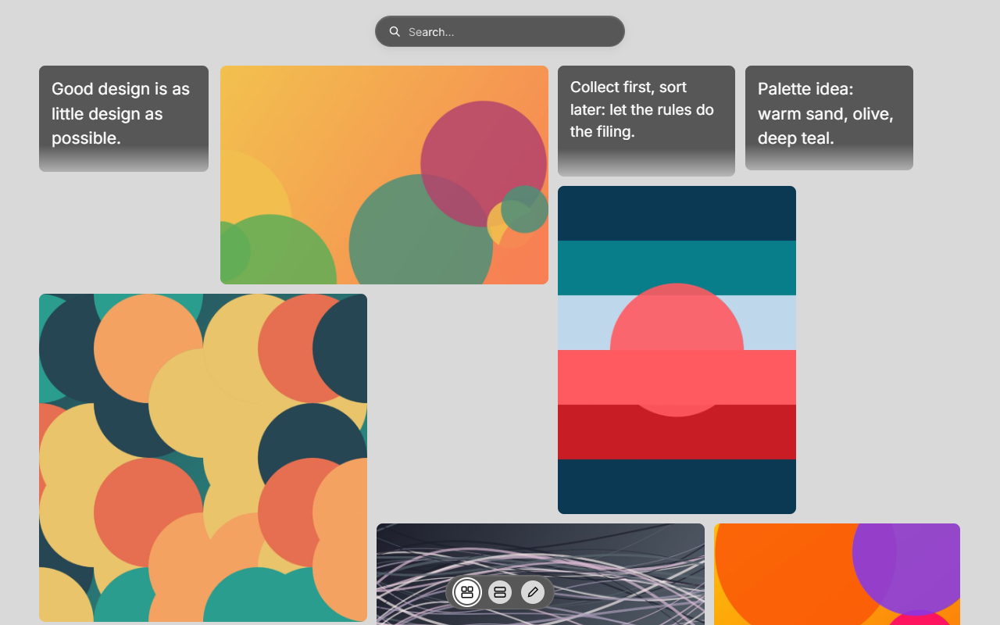
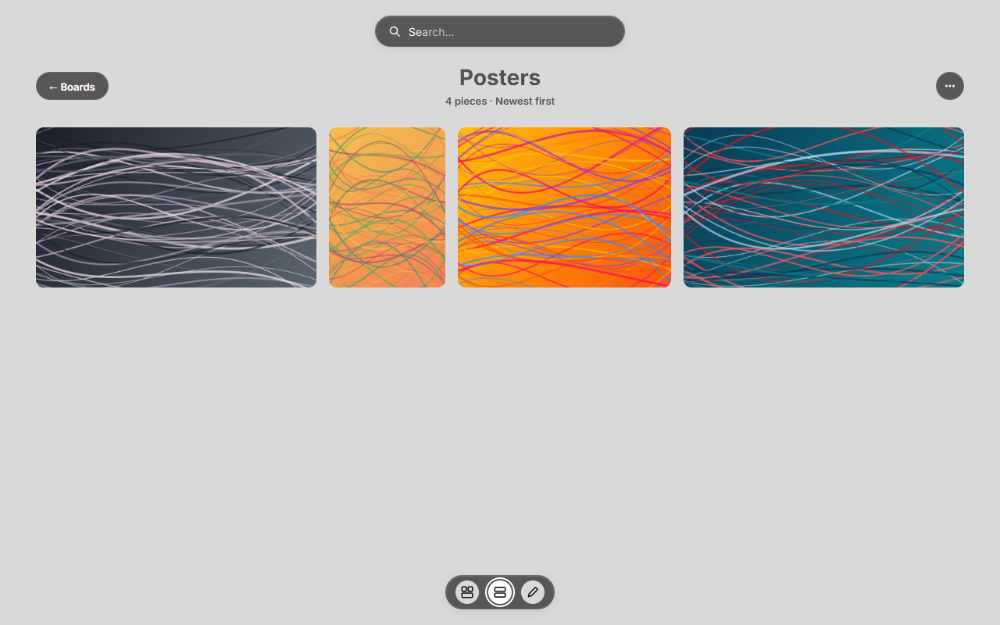
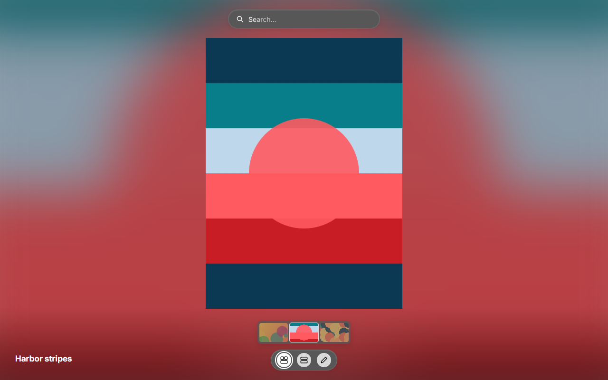
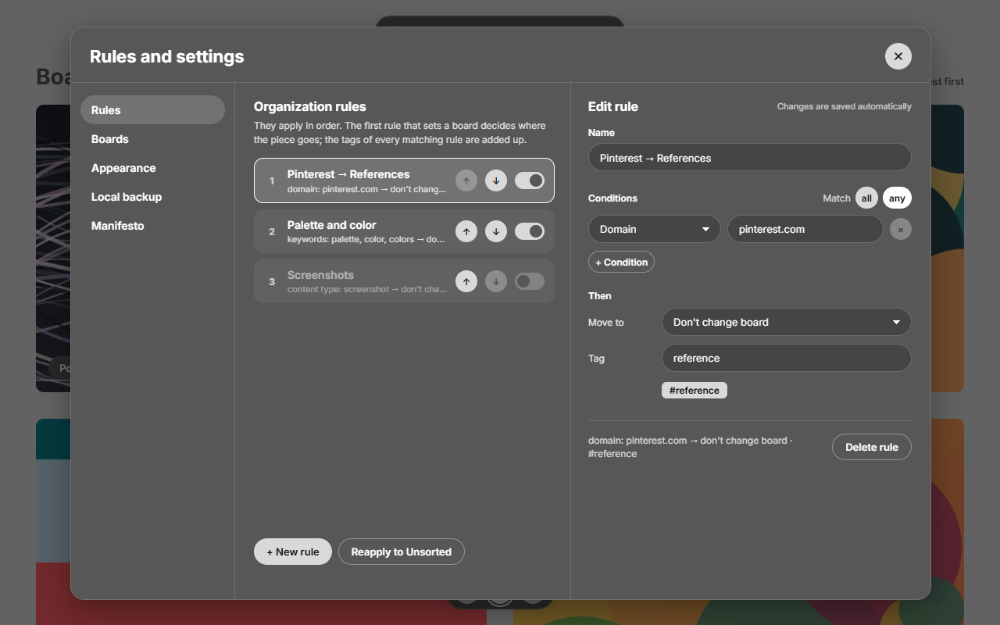
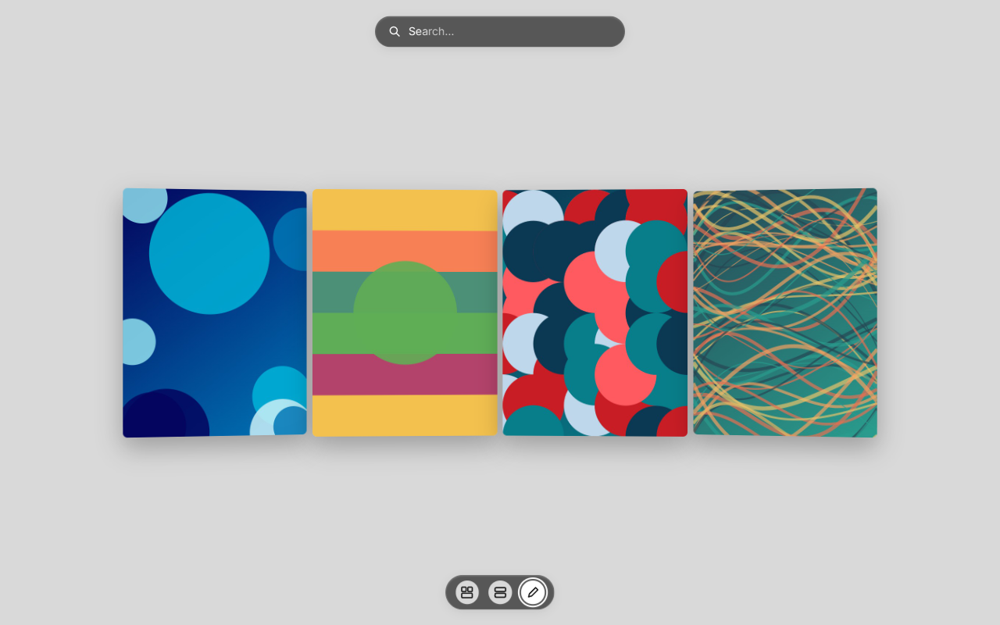
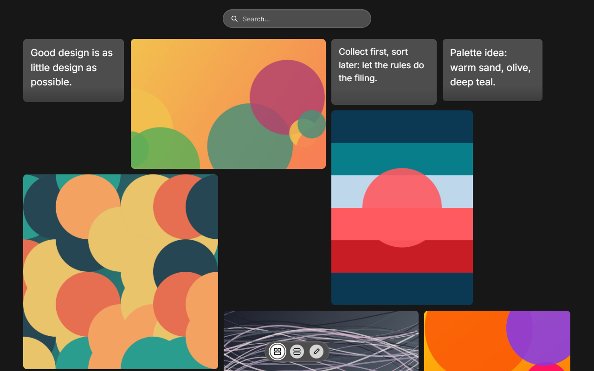

# Archivero

Your personal inspiration library. Save images, videos, links and text from any web page with a right-click (or `Alt+Shift+S`), and Archivero files them into boards by itself, following your own rules.

Everything stays in your browser: no accounts, no servers, no ads.



| Boards | Fullscreen |
| --- | --- |
|  |  |
| **Rules and settings** | **Notebook** |
|  |  |

## Features

- **Save from anywhere:** right-click an image, video, link or selected text → "Save … to Archivero", or press `Alt+Shift+S` to save the whole page.
- **Automatic sorting:** rules by site, keywords or content type choose the board and add tags.
- **Boards** in a gallery layout, an editable details card for every piece and automatic tags by site.
- **Infinite mosaic** of everything you saved, and a **fullscreen** slideshow.
- **Notebook** to draw, paste images and write notes.
- **Appearance:** light and dark themes, 12 palettes, 5 typefaces and 3 languages (English, Spanish, Portuguese).
- **Local backup:** export your whole library (pieces, boards and notes) to a `.json` file and restore it whenever you want.



## Install

Archivero isn't on the Chrome Web Store yet, so you install it by hand. It works on Chrome and other Chromium browsers (Edge, Brave, Opera…).

### Option A: download the ready-made extension (easiest)

1. Go to the [latest release](https://github.com/MateoMolina44/Archivero/releases/latest) and download `archivero-extension-vX.Y.Z.zip`.
2. Unzip it into a folder you'll keep (if you delete the folder, the extension stops working).
3. Open `chrome://extensions` (or `edge://extensions`, `brave://extensions`…).
4. Turn on **Developer mode** (top-right corner).
5. Click **Load unpacked** and pick the unzipped folder (the one with `manifest.json` inside).
6. Pin Archivero from the puzzle-piece menu so its button is always visible.

To update, download the new zip, replace the folder's contents and click the reload ↻ button on Archivero's card in `chrome://extensions`. Your library is kept.

### Option B: build it from the source code

You need [Node.js](https://nodejs.org) 18 or newer.

```bash
git clone https://github.com/MateoMolina44/Archivero.git
cd Archivero/extension
npm install
npm run build
```

Then follow steps 3–6 above and choose the `extension/dist` folder.

## How to use it

- **Save:** right-click anything on a page → "Save … to Archivero". A small notice lets you change the board or the tags right away.
- **Save the whole page:** `Alt+Shift+S`, or the extension button → "Save this page".
- **Open your library:** extension button → "Open my archivero".
- **Rules, appearance and language:** in the library, the "Rules and settings" button next to the bottom menu.
- **Backup:** Rules and settings → Local backup → Export backup (.json). Use "Import backup" in another browser or computer to move your library there.

## Good to know

- Your library lives in the browser profile where you installed the extension. It doesn't sync between devices: use Export/Import to move it.
- Browsers don't let extensions run on some pages (`chrome://` pages, the Chrome Web Store, the new tab page), so you can't save from those.
- Some sites block link previews; those links are saved as a plain card.
- The web version at https://archivero-green.vercel.app shows the library only: it can't save from other pages and doesn't share data with the extension.

## Project structure

- `extension/`: the actual code (Vite). `npm run build` creates the MV3 extension in `dist/`, `npm run build:web` the web version in `dist-web/`. Developer notes (in Spanish) in `extension/README.md`.
- `diseno/`: the approved design (`project/*.dc.html`, the source of truth for the UI) and its generators.
- `docs/screenshots/`: the screenshots above.
- `CLAUDE.md`: design decisions and how the app is put together (in Spanish).
- `PUBLICAR_EN_CHROME.md`: guide to publish the extension on the Chrome Web Store (in Spanish).

The web version is deployed on Vercel with every push to `main` (config in `vercel.json`).

## License

[MIT](LICENSE) © 2026 Mateo Molina. You can use, change and share Archivero freely, as long as you keep the copyright notice.
